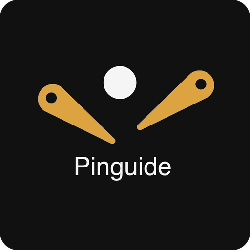
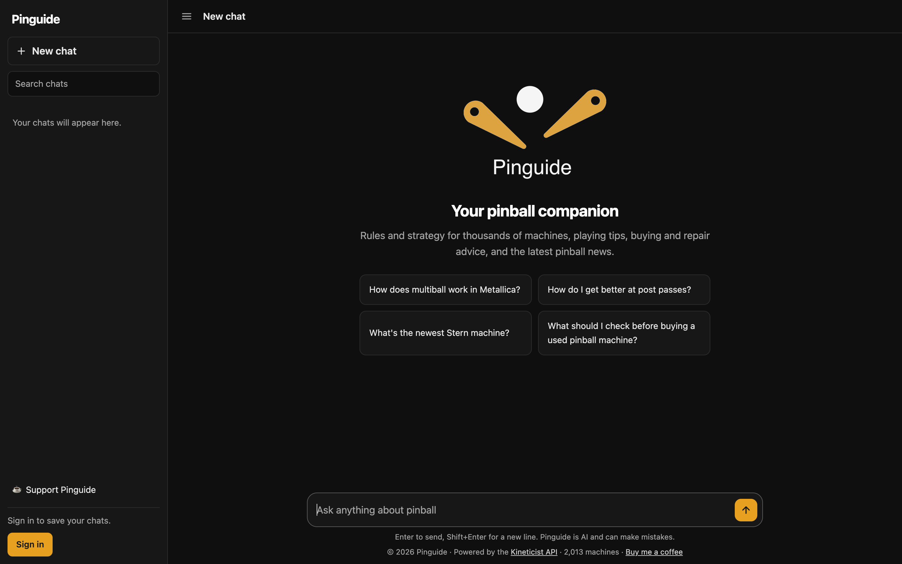

<p align="center"></p>

# Pinguide

An AI pinball companion in the style of claude.ai. Ask anything about pinball: rules, modes and strategy for a specific machine, playing technique, tournaments, buying and repairing machines, collecting, history, or the latest news. Answers stream in as they're written, with the model's thought process available in a collapsible panel. For specific machines Pinguide draws on a library of real rulesheets, strategy guides and machine profiles (about 2,000 machines); for anything current it searches the web.

**Live:** [pinguide.info](https://pinguide.info)



Built as a personal project. Not commercial (an optional "Buy me a coffee" tip link only).

---

## Table of contents

- [Features](#features)
- [What the library covers](#what-the-library-covers)
- [How it works](#how-it-works)
- [Retrieval strategy](#retrieval-strategy)
- [Tech stack](#tech-stack)
- [Costs and limits](#costs-and-limits)
- [Project structure](#project-structure)
- [Local setup](#local-setup)
- [Deployment](#deployment)
- [Planned](#planned)

---

## Features

- Chat history in a left sidebar (Today / Previous 7 days / Older), with search, rename and delete
- Optional sign-in (Google or an emailed link) to save chats across devices; without an account you can still chat, nothing is saved
- Streaming answers with a Stop button; Markdown formatting; Copy, Retry and Edit
- "Thought process" panel (the model's reasoning summary) and "Searched the web for ..." lines
- Source chips for library rulesheets and web pages
- "How to use Pinguide" help for first-time visitors (sidebar, footer and welcome screen)
- Phone layout with a slide-out sidebar; keyboard accessible, WCAG AA contrast

---

## What the library covers

| Source | What it is | Machines |
|---|---|---|
| [Pinball Rulesheets](https://pinballrulesheets.com) | Community rulesheets for modern machines (successor to the Tiltforums wikis; CC0 repo [heyrocker/pinballrules](https://github.com/heyrocker/pinballrules)) | ~91 |
| Tiltforums archive | 6 older Tiltforums rulesheets not carried over to the new site (Tiltforums closed in 2026) | 6 |
| [PAPA rulesheet archive](https://papa.org) | Classic machine rulesheets | ~141 |
| [Bob's Guide](https://rules.silverballmania.com) | Strategy guides for classic and EM-era machines | ~413 |
| [Stern Pinball](https://sternpinball.com) | Official pages for current Stern machines: overview, gameplay features, edition (Premium/LE) differences | ~81 |
| [Chicago Gaming](https://www.chicago-gaming.com) | Official pages for CGC remakes (Medieval Madness, Attack from Mars, Monster Bash, Cactus Canyon, Pulp Fiction) | 5 |
| [Kineticist](https://www.kineticist.com) ([API](https://www.kineticist.com/docs/api)) | Machine profiles: description, years, design team, editions with price and production run, and for 66 games a transcribed "keys to the game" tutorial. Data provided by Kineticist. | ~1,780 |
| Smaller makers | Official pages from Multimorphic (26 P3 games), Spooky, Pinball Brothers, Dutch Pinball, Turner, American Pinball, and Barrels of Fun code update notes | ~55 |

About **2,000 machines** and **18,800 indexed chunks** in total. Many machines (about 1,100) have only a Kineticist profile, not a full rulesheet, and answers say so.

---

## How it works

Built once (and refreshed now and then):

1. **Scrape:** seven scrapers fetch rulesheets, manufacturer pages and Kineticist profiles and save structured JSON to `data/raw/`
2. **Ingest:** chunks each source by section, generates embeddings via OpenAI, and stores everything in a ChromaDB vector store (~380 MB on disk)

For each message:

3. **Answer:** `POST /api/chat` streams Server-Sent Events. If the question (or the conversation so far) names a machine, the library is searched for that machine and the best excerpts are attached. Claude Haiku 5.5 then streams its answer, thinking first and calling web search when it needs current information. The first answer of a chat also gets a short generated title. For signed-in users the exchange is saved in SQLite.

General questions with no machine named skip the library: its nearest chunks would come from arbitrary machines and pull the answer off topic, so the model answers as an expert from its own knowledge, plus the web.

---

## Retrieval strategy

Used when a machine is in scope:

**Game name filtering:** retrieval is restricted to chunks from the named machine. The system handles manufacturer-prefixed titles ("Stern Godzilla" vs. "Godzilla") and expands to variants (e.g. "Trident" also retrieves "Trident 2022"). Follow-ups that don't name a machine stay with the one under discussion.

**HyDE (Hypothetical Document Embeddings):** pinball questions use everyday language; rulesheets use domain-specific terminology. Before searching, the LLM writes a short hypothetical rulesheet excerpt that would answer the question, and we embed that instead of the raw question.

**Reranking:** Voyage AI's `rerank-2` cross-encoder scores each (question, chunk) pair and reorders them. The top 5 go to the LLM for one machine; when several machines share a title (e.g. Metallica and Metallica Remastered), each is queried separately, the top 8 are kept, and each machine gets its own answer section.

---

## Tech stack

| Layer | Tool |
|---|---|
| RAG framework | LlamaIndex |
| Vector store | ChromaDB (on disk) |
| Embeddings | OpenAI `text-embedding-3-small` |
| Reranking | Voyage AI `rerank-2` |
| LLM | Anthropic Claude Haiku 5.5, with adaptive thinking and the web search tool |
| API | Flask + gunicorn (threaded, streaming) |
| Accounts and saved chats | SQLite; Authlib (Google sign-in); Resend (email links) |
| Frontend | Plain HTML/CSS/JS, marked + DOMPurify |
| Deployment | Railway + Cloudflare |

---

## Costs and limits

**One-time:** embedding the full corpus costs about $0.40 in OpenAI credits.

**Per answer** (estimates from testing; Claude Haiku 5.5 is $0.10 / $0.50 per million input/output tokens):

| Answer | Cost |
|---|---|
| No web search | ~$0.002 |
| With web search | ~$0.012 to $0.025 ($0.01 per search plus reading the results) |
| Chat title (first answer only) | ~$0.0002 |

**Web search limits** (each can be changed with an environment variable): 3 searches per answer, 25 per day for each visitor who isn't signed in, 100 per day for each signed-in user, and 300 per day for the whole site (about $3). Past a limit, answers still work, without searching.

---

## Project structure

```
pinguide-rag/
├── scraper/          # pinballrules.py, kineticist.py, makers.py, papa.py, bobs_guide.py, stern.py, cgc.py
├── ingest/           # pipeline.py: chunk, embed, store
├── api/              # app.py (streaming chat), auth.py (sign-in), db.py (SQLite)
├── frontend/         # index.html, app.css, app.js, logo and icons
├── docs/             # logo and screenshot for this README
├── data/raw/         # scraped JSON (committed to git)
└── vector_store/     # ChromaDB data + app/pinguide.db (Railway Volume, not in git)
```

---

## Local setup

**Prerequisites:** Python 3.11, API keys for [Anthropic](https://console.anthropic.com), [OpenAI](https://platform.openai.com), and [Voyage AI](https://voyageai.com).

```bash
git clone <repo-url>
cd pinguide-rag
python3.11 -m venv venv
source venv/bin/activate
pip install -r requirements.txt
cp .env.example .env   # then fill in your keys
```

Scraped data is already committed, so you can go straight to ingest:

```bash
python -m ingest.pipeline   # ~$0.40 in OpenAI embedding credits
gunicorn -c gunicorn.conf.py -b 127.0.0.1:5002 api.app:app
```

Then open http://localhost:5002. Without `RESEND_API_KEY`, email sign-in links are printed in the server output instead of being emailed. Google sign-in needs `GOOGLE_CLIENT_ID` and `GOOGLE_CLIENT_SECRET`; the button is hidden without them.

To re-scrape fresh data first:

```bash
python -m scraper.pinballrules
python -m scraper.papa
python -m scraper.bobs_guide
python -m scraper.stern
python -m scraper.cgc
python -m scraper.kineticist   # about an hour; transcribes tutorial images once (ANTHROPIC_API_KEY)
python -m scraper.makers       # after kineticist (uses its game names)
```

`python -m ingest.pipeline --dry-run` prints the machine-name reconciliation and machine count without embedding anything.

---

## Deployment

Runs on [Railway](https://railway.com) as a Python web service. ChromaDB and the SQLite database live on a 5 GB Railway Volume mounted at `/app/vector_store` (not in git). The ingest never touches the database folder. The vector store is **not** rebuilt by a deploy: after data changes, open the service's Console in the Railway dashboard, run `.venv/bin/python -m ingest.pipeline`, then restart the service.

- **Build:** `pip install -r requirements.txt`
- **Start:** `gunicorn api.app:app` (settings in `gunicorn.conf.py`)
- **Environment variables:** API keys, `SECRET_KEY`, Google and Resend settings, and the optional `PINGUIDE_SUPPORT_URL` (see `.env.example`)
- **Domain:** `pinguide.info` via Cloudflare DNS

---

## Planned

Playfield layout support for location questions ("where is the snake scoop in Metallica Remastered?"). The current text rulesheets describe elements by *function* (what the Snake does), not *position* (where it is), so these questions are weak today.

A feasibility review favors generating per-machine "Playfield Layout" text **offline** from a top-down playfield image via a vision-capable Claude model, then ingesting it as an ordinary section so the existing text retrieval answers location questions (no per-query vision cost, no frontend change). The technique is sound; the blocker is **sourcing permitted top-down playfield images**. The good sources (IPDB, Pinside) block AI use, Wikimedia Commons has no usable images for these machines, and a Google-style search confers no usage rights. The only viable path is owner-supplied images for a curated set of machines. **Deferred** until such images are available.
